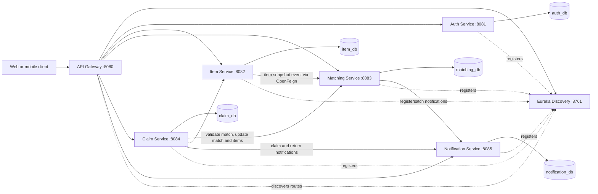

# LostLink — Smart Lost & Found Platform

LostLink is a backend platform for helping people reunite with lost belongings. A user can publish a **LOST** report, another user can publish a **FOUND** report, and the platform compares the reports using transparent rules. When a likely match is found, the owner can submit an ownership claim, the finder can review it, and an approval marks the reports as returned and notifies both people.

The project is implemented in Java 21 with Spring Boot 3.4.5 as a Maven multi-module microservices application. It is designed as a runnable interview/demo project: authentication, item reporting, matching, claims, and notifications are implemented as separate services, and a Docker Compose file provides a local environment. Matching uses a deterministic Java scoring algorithm; no paid AI API or external AI service is required.

## Project description

**Problem:** Lost-item reports are often scattered across messages or community groups, making it difficult to discover when someone has reported the same item as found.

**Solution:** LostLink provides a versioned REST API for creating and searching lost/found reports. Its matching service compares category, location, date, and normalized description text, ranks potential matches, and stores suggestions. A claim workflow lets the lost-item owner provide proof details for the finder to review. A notification service records updates for the relevant users.

**Intended users:** People reporting lost or found property, finders reviewing ownership claims, and administrators managing the demo application.

**Project scope:** This repository contains the backend APIs and local infrastructure—not a web or mobile frontend. Notifications are persisted and logged; email delivery is an extension point, not yet configured. The services use synchronous REST calls for this demonstration, so this is not a distributed-transaction or durable-event production system.

### Main capabilities

- Register and log in with BCrypt-protected passwords and expiring JWT access tokens.
- Create, search, page, update, and manage lost/found item reports with ownership checks.
- Suggest opposite-type matches with a score from 0 to 100 and a minimum threshold of 50.
- Submit claims, restrict access to proof details, and allow finders/admins to review claims.
- Record per-user notifications and mark them read individually or all at once.
- Discover services through Eureka and route client requests through Spring Cloud Gateway.

## Architecture



### Services

| Module | Responsibility |
|---|---|
| `discovery-server` | Eureka registry |
| `api-gateway` | Single HTTP entry point, discovery-based routes, JWT validation and CORS |
| `auth-service` | Registration, BCrypt password storage, login, signed JWTs and current profile |
| `item-service` | Lost/found reports, owner/admin changes, filters and pageable listings |
| `matching-service` | Item snapshots, scoring, ranked match suggestions and match lifecycle |
| `claim-service` | Claim submissions, proof visibility, finder/admin review and return coordination |
| `notification-service` | Persistent per-user notifications and read state; logs queued delivery for future email integration |
| `common` | Shared JWT authentication, internal Feign authentication, API errors and DTOs |

Services use separate MySQL databases and store cross-service IDs as UUID values; there are no cross-database JPA relationships. Schema tables are created/updated by Hibernate (`ddl-auto: update`) for this demonstration.

## Technology

- Java 21, Spring Boot 3.4.5, Spring Cloud 2024.0.1
- Maven, Spring MVC, Spring Data JPA, Bean Validation, Spring Security
- HMAC-signed JWTs (JJWT), BCrypt, MySQL 8.4
- Eureka, Spring Cloud Gateway, OpenFeign
- springdoc OpenAPI / Swagger UI, JUnit 5, Mockito, Docker Compose

## Run locally with Docker Compose

Docker Compose is the simplest way to run the complete system, including the five isolated databases.

1. Copy `.env.example` to `.env`.
2. Replace the example database passwords, JWT secret, and internal service key with local random values. Use a JWT secret of at least 32 UTF-8 bytes. Keep `.env` private; it is git-ignored.
3. Start the stack:

   ```sh
   docker compose up --build
   ```

Compose waits for MySQL, Eureka, and service health checks before starting dependents. Initial builds download Maven dependencies and may take several minutes. Once healthy:

- Gateway: <http://localhost:8080>
- Eureka dashboard: <http://localhost:8761>
- Swagger UIs: `http://localhost:8081/swagger-ui/index.html` through `http://localhost:8085/swagger-ui/index.html`
- OpenAPI JSON: `http://localhost:<service-port>/v3/api-docs`

Use the gateway for normal client requests. Direct service ports are exposed for local debugging. The database initialization script creates `auth_db`, `item_db`, `matching_db`, `claim_db`, and `notification_db`.

Stop with `docker compose down`. To preserve local data, do not remove the `mysql_data` volume. To reset this demo database, explicitly remove that volume with `docker compose down -v`.

## Run services individually

Install Java 21, Maven, and MySQL 8.4. Create the five databases and grant the local application DB user access to them. Then export `JWT_SECRET` (32 bytes minimum), `INTERNAL_SERVICE_KEY`, `DB_USERNAME`, and `DB_PASSWORD`. Start `discovery-server` first, then the service modules, then `api-gateway`:

```sh
mvn -pl discovery-server spring-boot:run
mvn -pl notification-service spring-boot:run
mvn -pl matching-service spring-boot:run
mvn -pl item-service spring-boot:run
mvn -pl claim-service spring-boot:run
mvn -pl auth-service spring-boot:run
mvn -pl api-gateway spring-boot:run
```

Each business service has a local JDBC URL default in its `application.yml`; set `DB_URL` to the corresponding schema and set the DB credentials in the environment. The URL, Eureka address, JWT expiry, CORS allow-list, and ports are environment-overridable. Internal service calls use a distinct `INTERNAL_SERVICE_KEY`; do not reuse the JWT secret for it.

## Authentication and authorization

Register or log in through the gateway. The response includes a bearer token; send it as `Authorization: Bearer <accessToken>` for all other requests. Tokens contain user UUID, email, role, issuance time, and an expiry (`JWT_EXPIRATION_MS`, default one hour). Every service validates the same signature and expiry. Passwords are never returned or stored in plaintext.

Registration always creates `USER`; it does not accept a client-supplied role. For local admin demonstrations, promote a trusted account by changing its `role` to `ADMIN` in `auth_db.users` using a controlled database session. User-owned item changes, claim visibility, and notification access are enforced in the owning service. Internal item status updates and notification creation require the separate service key; arbitrary identity headers are not used.

CORS defaults to `http://localhost:3000,http://localhost:5173`; set `CORS_ALLOWED_ORIGINS` to the exact frontend origins required by your environment. Credentials are not enabled for CORS.

## REST APIs

All API paths are versioned with `/api/v1`. Except registration/login and API documentation/health endpoints, client APIs require a valid JWT.

| Service | Method and path | Purpose |
|---|---|---|
| Auth | `POST /api/v1/auth/register` | Register a USER |
| Auth | `POST /api/v1/auth/login` | Authenticate and issue access token |
| Auth | `GET /api/v1/users/me` | Current authenticated profile |
| Items | `POST /api/v1/items` | Create LOST or FOUND report |
| Items | `GET /api/v1/items` | Filter and page (`category`, `itemType`, `status`, `location`, `q`, `page`, `size`, `sort`) |
| Items | `GET /api/v1/items/search` | Same filters via explicit search path |
| Items | `GET /api/v1/items/my-items` | Page current user's reports |
| Items | `GET /api/v1/items/{id}` | Item details |
| Items | `PUT /api/v1/items/{id}` | Owner/admin edits report |
| Items | `PATCH /api/v1/items/{id}/status` | Owner/admin changes status |
| Items | `DELETE /api/v1/items/{id}` | Owner/admin deletes report |
| Matches | `GET /api/v1/matches/item/{itemId}` | Ranked suggestions for an involved user's item |
| Matches | `GET /api/v1/matches/my-matches` | Matches involving current user |
| Matches | `GET /api/v1/matches/{matchId}` | Match details, restricted to participants/admin |
| Matches | `PATCH /api/v1/matches/{matchId}/status` | Participant/admin match status |
| Claims | `POST /api/v1/claims` | Lost-item owner submits claim |
| Claims | `GET /api/v1/claims/my-claims` | Claimant's claims |
| Claims | `GET /api/v1/claims/review-queue` | Found-item owner's claims (or all for ADMIN) |
| Claims | `GET /api/v1/claims/{claimId}` | Claim details for claimant, finder, or ADMIN |
| Claims | `PATCH /api/v1/claims/{claimId}/status` | Finder/admin approves or rejects; claimant/admin cancels |
| Notifications | `GET /api/v1/notifications` | Current user's notifications |
| Notifications | `PATCH /api/v1/notifications/{id}/read` | Mark one owned notification read |
| Notifications | `PATCH /api/v1/notifications/read-all` | Mark all current user's notifications read |

Item categories: `ELECTRONICS`, `ACCESSORIES`, `DOCUMENTS`, `CLOTHING`, `KEYS`, `BAGS`, `OTHER`. Item types: `LOST`, `FOUND`. Item statuses: `OPEN`, `MATCHED`, `CLAIMED`, `RETURNED`, `CLOSED`. Match statuses: `SUGGESTED`, `ACCEPTED`, `REJECTED`, `CLAIM_IN_PROGRESS`, `COMPLETED`. Claim statuses: `PENDING`, `APPROVED`, `REJECTED`, `CANCELLED`.

Validation errors and expected HTTP errors use a consistent JSON shape:

```json
{
  "timestamp": "2026-11-03T11:00:00Z",
  "status": 400,
  "error": "Bad Request",
  "message": "Request validation failed",
  "validationErrors": {"title": "must not be blank"}
}
```

## Matching rules

Only open LOST reports are compared with open FOUND reports. Scores are additive, capped at 100, and suggestions are persisted only when the score is at least 50:

| Rule | Points |
|---|---:|
| Same category | 30 |
| Same location after case/punctuation/whitespace normalization | 25 |
| Same date / 1–2 days / 3–7 days apart / more than 7 days | 20 / 15 / 10 / 0 |
| Title token overlap | Up to 15 |
| Description token overlap | Up to 10 |

Text is lowercased, punctuation is normalized to spaces, and words are compared using intersection size divided by the larger unique-word set size. This overlap coefficient gives full points when all words in the shorter phrase occur in the longer phrase; there are no AI or paid external matching APIs. A unique ordered UUID pair prevents duplicate match rows.

## Example user journey

The [Postman collection](./postman/LostLink.postman_collection.json) includes a runnable sequence that captures tokens and IDs for two users.

Register and log in:

```sh
curl -sS http://localhost:8080/api/v1/auth/register \
  -H 'Content-Type: application/json' \
  -d '{"fullName":"Alex User","email":"alex@example.com","password":"example-pass-123"}'
```

Report a lost item using the returned token:

```sh
curl -sS http://localhost:8080/api/v1/items \
  -H "Authorization: Bearer $TOKEN_A" -H 'Content-Type: application/json' \
  -d '{"title":"Black wireless headphones","description":"Black over-ear headphones with a blue case","category":"ELECTRONICS","itemType":"LOST","location":"Office Cafeteria","itemDate":"2026-11-03"}'
```

Have a second user report a similar FOUND item. The item service publishes its snapshot to matching; suggestions with score >= 50 are stored, and both item owners receive a notification. The lost-item owner can read `/api/v1/matches/my-matches`, then submit `{"matchId":"<match UUID>","description":"I can identify the device pairing name","proofDetails":"Serial number and purchase details"}` to `/api/v1/claims`. The finder reviews the claim from their `/api/v1/claims/review-queue` and patches the claim status to `APPROVED` or `REJECTED`. Approval marks both reports `RETURNED`, completes the match, and emits claim/return notifications.

`proofDetails` is returned only to the claimant, the finder, or an administrator. Do not send sensitive documents or credentials as proof in a real deployment; this demo stores proof text directly in the claim database.

## Testing and build

```sh
mvn test
mvn verify
```

Unit tests exercise BCrypt registration/login and duplicate-email handling, JWT validation, item request validation and ownership, matching score/date/word rules, LOST-vs-FOUND direction, threshold behavior and duplicate suppression, claim approval/rejection and proof visibility, active-claim uniqueness keys, and notification ownership/read state. The full database-backed claim and Compose end-to-end workflow should be run in an environment with Docker/MySQL before production use.

## Operational notes

- Feign calls are synchronous and use the incoming JWT for user-context calls; notification and trusted item-status calls use the separately configured internal service key.
- Item creation remains persisted if Matching is unavailable; the service logs the missed match event. Update the report after restoring Matching to publish a fresh snapshot. Durable retries/outbox delivery are appropriate before production.
- Claim-to-item/match/notification coordination spans independent databases and is not a distributed transaction. Failures are logged and surfaced as service errors; inspect service logs and status records if a downstream service fails mid-workflow.
- This is an interview/demo-grade baseline, not a production deployment template. Before production, add migrations, rate limiting, secret management, key rotation, audit trails, durable event delivery, observability, and deployment-specific CORS/TLS controls.
